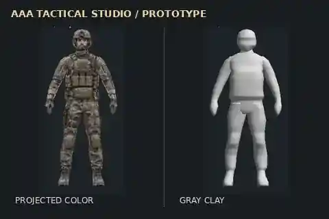

# AAA Tactical Character Studio — Benchmark 01

**Disposition: PROTOTYPE / NOT AAA / NOT production-ready.** This is a real static 3D diagnostic envelope derived from a synthetic character turnaround, not a completed high-poly sculpt or evidence that the skill passes its quality gates.

## Reproduce and inspect

- [Interactive CPU 3D preview](preview.html) — actual triangle rasterization with per-pixel depth testing; orbit, zoom, front/side/back presets, projected color, gray clay and wireframe.
- [GLB](operator.glb) — self-contained static mesh with an embedded compact JPEG texture.
- [Geometry source](build.mjs) and [input atlas](atlas.jpg). Run `node build.mjs` from the example folder (see source for usage). Serve this folder with a local static HTTP server, e.g. `python -m http.server 8000`, then open `http://localhost:8000/preview.html`.
- Source reference: AI-generated fictional operator concept from the benchmark conversation; front, back and one profile crop. The fourth view repeats the profile direction, so it was excluded as independent evidence. Opposite side and depth were inferred. No external anatomy asset was used.

## Measured facts

| Item | Result |
|---|---|
| GLB version | 2.0 |
| Triangles | 21,120 |
| Vertices (including UV splits) | 12,512 |
| GLB size | 660,400 bytes |
| Assumed height | 1.80 m; not measured from a physical subject |
| Mesh construction | Parametric cross-section lofts, separate intersecting envelope components, projection seam splits |
| Texture | Compact synthetic reference RGB with baked lighting; not physically based or independently calibrated |
| Rig / skin / animation | None |
| Web asset SHA-256 | `b3ccf949d53209f3200dd5ae4b7b5feefcbd27cb38bb4d6f751af9d7eaede55b` |
| Atlas SHA-256 | `cd94471a9e84ebdf4107da7c3f31982280623635464e3e40f7f1c074abf55010` |

## Quality gates

| Gate | Disposition | Evidence and reason |
|---|---|---|
| G0 | BLOCKED | Independent opposing profile and credible licensed human base absent; depth is inferred. |
| G1 | NOT PASSED | Actual gray-clay inspection reveals coarse face, fused fingers, simplified anatomical forms and overlaps between body parts. |
| G2–G7 | NOT RUN | Clothing and gear require actual separable geometry; retopology, anatomical UV, PBR baking, deformation, performance and independent release review are not established. |

The benchmark envelope bypasses sculpt completion only for diagnostic demonstration. It must not be marked as a release or promoted to a passing result based on projected color.

## Browser QA

Local Chromium headless: WebGL2 unavailable. The dependency-free Canvas 2D software rasterizer was tested with the exact compact GLB bytes injected via data URL into the preview (the local HTTP navigation is blocked in the execution environment). Geometry loaded with 21,120 triangles and 12,512 vertices; color, clay and wireframe each drew 73,434 opaque pixels at the tested initial camera, the back preset was exercised, and no page errors were reported. Node syntax check passed. The static GitHub Pages deployment is not part of this local test; no GPU/frame-time or mobile benchmark is claimed.

The thumbnail is a render of the exact compact web GLB, not the concept reference or a separate photorealistic render. Full-quality output requires completing the skill's gates with actual anatomy, separate clothing and equipment, proper PBR materials and rigging.

