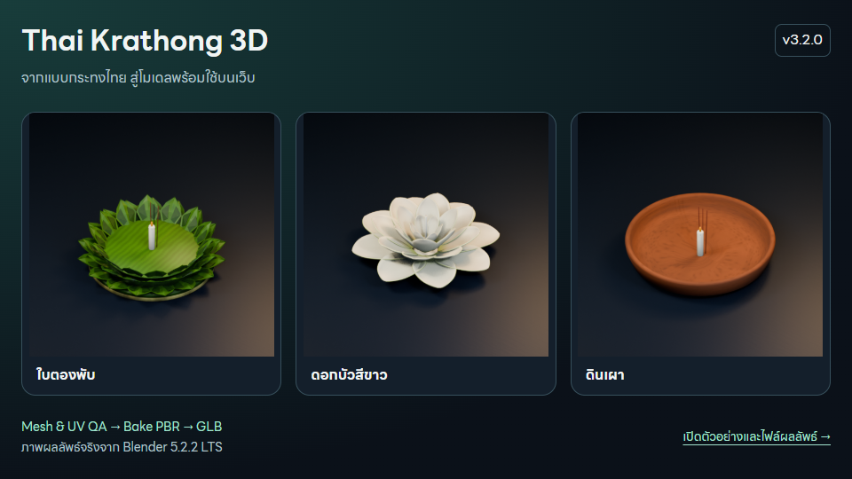

# ตัวอย่างผลลัพธ์ Thai Krathong 3D v3.2.0

เปิด [ภาพรวม](overview.html) หรือ [หน้าเลือกตัวอย่าง](index.html) เพื่อดูภาพเรนเดอร์ 3 มุม คัดลอก prompt และดาวน์โหลดไฟล์ GLB ที่ฝัง PBR textures แล้ว หน้าเว็บใช้ฟอนต์และไฟล์ประกอบในโฟลเดอร์นี้ ไม่ต้องโหลด JavaScript/font จาก CDN

ภาพทั้งหมดมาจาก **GLB ที่เปิดกลับใน Blender 5.2.2 LTS** โมเดลและพิกเซลเป็นไฟล์จริงจากรอบตรวจ v3.2.0 โดยคง bytes เดิม ไม่ใช่ภาพจำลองแทนโมเดล หน้า gallery แสดงภาพเรนเดอร์ ไม่ใช่ตัวหมุนโมเดล 3D แบบ realtime



## เลือกตัวอย่าง

| ตัวอย่าง | Triangles | UV islands | Atlas | GLB |
| --- | ---: | ---: | --- | ---: |
| [กระทงใบตอง](results/banana/iso.png) | 9,256 | 1,586 | 1,024 px | [ดาวน์โหลด 5.54 MB](results/banana/krathong.glb) |
| [กระทงดอกบัว](results/lotus/iso.png) | 34,928 | 2,486 | 2,048 px | [ดาวน์โหลด 24.29 MB](results/lotus/krathong.glb) |
| [กระทงดินเผา](results/clay/iso.png) | 6,064 | 85 | 1,024 px | [ดาวน์โหลด 4.55 MB](results/clay/krathong.glb) |

แต่ละโฟลเดอร์มี `iso.png`, `front.png`, `top.png`, `krathong.glb` และ `verification.json` พร้อม SHA256/ขนาดไฟล์/ผลตรวจ รุ่นดอกบัวมีหนึ่งหน้าในสำเนาสำหรับเว็บที่ปรับเป็น flat shading เพื่อแก้ zero tangent ตามรายงาน ต้นฉบับไม่ถูกเขียนทับ

## ตัวอย่าง prompt

Prompt ต่อไปนี้เป็นแนวทางเรียก skill ไฟล์ชุดนี้สร้างจาก preset และ CLI workflow ที่ตรวจจริง ไม่ได้อ้างว่าเป็นผลของการรัน prompt ใน chat ใหม่ ผลลัพธ์อาจต่างกันตามการปรับแบบและคุณภาพเป้าหมาย

### กระทงใบตอง

```text
ใช้ $thai-krathong-3d สร้างกระทงใบตองทรงกลมตาม preset banana_classic มีชั้นใบตองพับ ดอกไม้ เทียนและธูป ใช้สีเขียวธรรมชาติ เก็บลายเส้นใบตองให้ถูกทิศ ส่งออก GLB สำหรับเว็บ พร้อม Mesh/UV QA, baked PBR และภาพตรวจด้านหน้า ด้านบน และมุมเฉียง
```

Preset: [assets/ref-banana-classic.json](../../assets/ref-banana-classic.json)

### กระทงดอกบัว

```text
ใช้ $thai-krathong-3d สร้างกระทงทรงดอกบัวสีขาวนวลตาม preset white_lotus กลีบกว้างมีความหนาและแอ่งโค้ง แยกชั้นกลีบชัดเจน ตรวจ silhouette และ UV overlap ก่อน bake Normal และ ORM ส่งออก GLB ฝัง texture พร้อมเปิดกลับตรวจและเรนเดอร์สามมุม
```

Preset: [assets/ref-white-lotus.json](../../assets/ref-white-lotus.json)

### กระทงดินเผา

```text
ใช้ $thai-krathong-3d สร้างกระทงดินเผาตาม preset clay_bowl ให้เห็นช่องภายใน ผนังและขอบภาชนะจริง ผิวสีดินเผาไม่เป็นโลหะ มีเทียนและธูป ส่งออก GLB สำหรับเว็บ พร้อม baked PBR, UV QA และรายงานตรวจไฟล์หลัง reimport
```

Preset: [assets/ref-clay-bowl.json](../../assets/ref-clay-bowl.json)

## สร้างซ้ำด้วย Blender

รันจาก root ของ skill และใช้ output directory ใหม่สำหรับแต่ละรอบ ตัวอย่างใบตอง:

```bash
blender -b --factory-startup --python-exit-code 1 --python scripts/build_reference.py -- --preset assets/ref-banana-classic.json --out-dir /absolute/new-source
blender -b --factory-startup --python-exit-code 1 --python scripts/bake_web_pbr.py -- --input /absolute/new-source/krathong.blend --out-dir /absolute/new-web --resolution 1024 --samples 16 --margin 4 --render
blender -b --factory-startup --python-exit-code 1 --python scripts/check_reference_model.py -- --input /absolute/new-web/krathong-web.glb --web-pbr --out /absolute/roundtrip.json
```

สำหรับดอกบัวใช้ `ref-white-lotus.json`, resolution `2048`, samples `16`, margin `4`; สำหรับดินเผาใช้ `ref-clay-bowl.json`, resolution `1024`, samples `16`, margin `8` รายละเอียดข้อกำหนดและข้อจำกัดอยู่ใน [Mesh/UV/PBR workflow](../../references/mesh-uv-web-pbr.md)

## ไฟล์ PBR ที่แนบ

โฟลเดอร์ [แผนที่ PBR ของกระทงใบตอง](index.html#maps-title) แนบ BaseColor, Normal, Roughness, Metallic, AO และ ORM จริง ขนาด 1024×1024 px ส่วน GLB **ทั้งสามแบบ** ฝัง BaseColor/Normal/ORM ของตัวเองไว้ครบ จึงไม่ต้องวางภาพแยกข้าง GLB

- BaseColor: sRGB, diffuse color only ไม่รวมแสง
- Normal: Non-Color, tangent space +Y
- ORM: Non-Color, R=AO / G=Roughness / B=Metallic
- Metallic สีดำเป็นค่าที่ถูกต้องสำหรับวัสดุใบตอง/ดอกไม้/ดินซึ่งไม่เป็นโลหะ

เมื่อนำเข้า Three.js ให้ใช้ GLTFLoader และคง material/texture settings ที่โหลดมา ไม่บังคับทุกภาพเป็น sRGB หรือ flipY ใหม่ ไม่ต้องเพิ่ม decoder สำหรับไฟล์ตัวอย่างที่ไม่ได้บีบอัดนี้

## หลักฐานและขอบเขต

- การทดสอบ skill เดิมที่ตรวจ hash ซ้ำก่อนนำไฟล์มาใช้: Mesh/UV `17/17` และ bake/export `8/8` ใน Blender 5.2.2 LTS
- GLB ทั้งสามแบบ: strict roundtrip ผ่าน; Khronos gltf-validator `2.0.0-dev.3.10` ตรวจได้ `0 errors / 0 warnings`
- [รายงาน skill](../../references/web-pbr-verification.json) และ verification.json ของแต่ละตัวอย่างระบุ hashes, triangle/UV counts และ settings จริง
- การสร้างหน้า showcase นี้ใช้ไฟล์ที่ตรวจแล้วโดยไม่เปลี่ยน geometry/maps จึงไม่จำเป็นต้อง bake ซ้ำเพื่อทำภาพปก
- ยังไม่ใช่การรับรองความเหมือนภาพอ้างอิง, การลอยน้ำจริง, FPS หรือคุณภาพบนอุปกรณ์เป้าหมาย ไฟล์ .blend ต้นฉบับและ log ขนาดใหญ่ไม่ได้รวมมาในชุดตัวอย่าง

## ฟอนต์และการเปิดใช้งาน

ใช้ LINE Seed Sans TH จาก [แหล่งทางการ](https://seed.line.me/) แบบ locally hosted พร้อม [notice](fonts/NOTICE.md) และ [OFL license](fonts/OFL.txt) ฟอนต์ไม่ได้ถูกแก้ไข

แนะนำเปิดผ่าน local HTTP server ตาม README ของ repository ข้อมูลตัวอย่างฝังอยู่ใน JavaScript และไฟล์ประกอบอยู่ในโฟลเดอร์เดียวกัน การเปิดแบบ `file://` และ clipboard/download ขึ้นกับ policy ของ browser; เครื่องมือทดสอบรอบนี้ไม่อนุญาต `file://` จึงยืนยันการใช้งานผ่าน HTTP เท่านั้น หน้า gallery ไม่ส่ง prompt หรือไฟล์ออกไปยังบริการภายนอก

ผลตรวจหน้า overview/gallery: [showcase-verification.json](showcase-verification.json)
