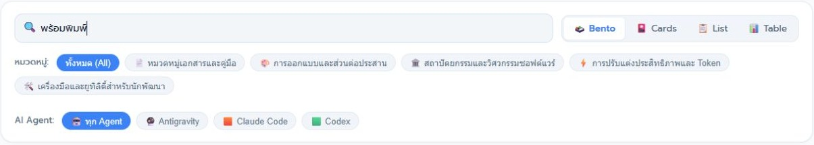
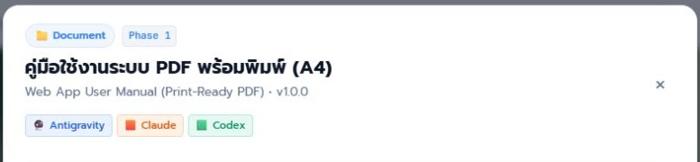
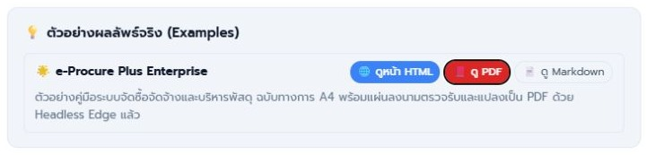
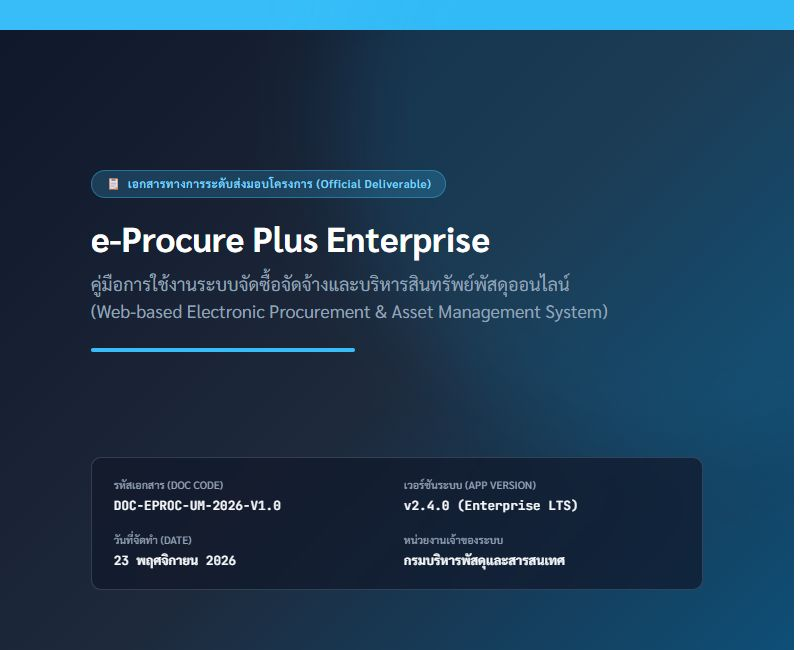

# เปิดตัวอย่างคู่มือ PDF พร้อมพิมพ์จาก AI Skill Library

ใช้คู่มือนี้เพื่อค้นหา Skill **คู่มือใช้งานระบบ PDF พร้อมพิมพ์ (A4)** และเปิดตัวอย่าง **e-Procure Plus Enterprise** เพื่อดูรูปแบบเอกสารก่อนนำ Skill ไปใช้

**สำหรับ** ผู้เข้าชมคลัง Skill ทั่วไป

**ก่อนเริ่ม** เปิด [AI Skill Library](https://codelv8-org.github.io/skills/) ในเบราว์เซอร์ ขั้นตอนนี้เปิดได้โดยไม่ต้องลงชื่อเข้าใช้หรือติดตั้ง Skill

## ขั้นตอนการใช้งาน

### Step 1 — ค้นหา Skill

พิมพ์ `พร้อมพิมพ์` ในช่องค้นหาของแคตตาล็อก ผลการค้นหาจะแสดงการ์ด **คู่มือใช้งานระบบ PDF พร้อมพิมพ์ (A4)**

*พิมพ์คำค้นในช่องด้านบน แล้วตรวจชื่อการ์ดที่แสดงด้านล่าง*

### Step 2 — เปิดรายละเอียด Skill

คลิก **ดูรายละเอียด** บนการ์ดที่พบ ระบบจะเปิดหน้าต่างรายละเอียดของ Skill บนหน้าเดิม

*ตรวจชื่อ Skill ที่ด้านบนของหน้าต่าง*

### Step 3 — หาตัวอย่างในหน้าต่างรายละเอียด

เลื่อนลงภายในหน้าต่างจนถึง **ตัวอย่างผลลัพธ์จริง (Examples)** แล้วมองหารายการ **e-Procure Plus Enterprise**

*ลิงก์ของตัวอย่างอยู่ทางขวาของชื่อรายการ*

### Step 4 — เปิดตัวอย่างเพื่ออ่าน

คลิก **ดูหน้า HTML** ในรายการ **e-Procure Plus Enterprise** เบราว์เซอร์จะเปิดแท็บใหม่และแสดงหน้าปกคู่มือพร้อมรหัสเอกสาร `DOC-EPROC-UM-2026-V1.0`

*เมื่อเห็นหน้าปก ให้เลื่อนลงเพื่ออ่านเนื้อหาคู่มือ*

## หากหาตัวอย่างไม่เจอ

ถ้ายังไม่เห็น **ตัวอย่างผลลัพธ์จริง (Examples)** ให้เลื่อนภายในหน้าต่าง **ดูรายละเอียด** ผ่านหัวข้อ **ไฟล์และเทมเพลตภายใน (Included Files)** แล้วตรวจว่าชื่อ Skill ด้านบนตรงกับ Step 1

> ตัวอย่างคู่มือนี้ตรวจขั้นตอนและจับภาพจากแคตตาล็อกบนเครื่องผ่าน Codex in-app browser เมื่อ 23 พฤศจิกายน 2026 เอกสาร e-Procure Plus ที่ใช้ประกอบเป็นตัวอย่างในคลัง
