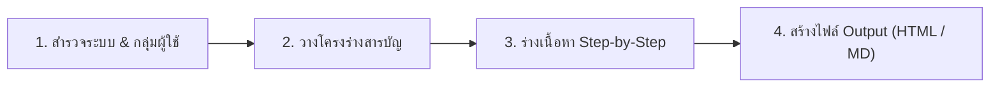

# Web Application User Manual Skill (คู่มือการใช้งานเว็บแอปพลิเคชัน)

Skill สำหรับสร้าง**คู่มือการใช้งานระบบ Web Application** อย่างมืออาชีพ ครอบคลุมทั้งรูปแบบ **Interactive HTML (พร้อมสารบัญ Sidebar, ค้นหา, Responsive, พิมพ์ PDF สวยงาม)** และ **Markdown สำหรับ Git/Wiki** เพื่อให้ผู้ใช้งานทั่วไป (End Users) หรือผู้ดูแลระบบ (Admin) สามารถอ่านและปฏิบัติตามได้อย่างเข้าใจง่าย รวดเร็ว และไม่สับสน

---

## 🎯 เมื่อไหร่ที่ควรใช้ Skill นี้ (Trigger Conditions)

เรียกใช้งาน Skill นี้ทันทีเมื่อผู้ใช้ร้องขอ:
- "สร้างคู่มือการใช้งานระบบ..." / "เขียน User Manual ของ Web App..."
- "ทำคู่มือผู้ใช้สำหรับระบบ..." / "จัดทำเอกสาร How-To สำหรับผู้ใช้งาน"
- "Generate user guide for web application..."
- ต้องการแปลงฟังก์ชันระบบ, หน้าจอเว็บ หรือโค้ด Frontend/Backend ให้กลายเป็นคู่มือขั้นตอนการใช้งานแบบ Step-by-Step

---

## 🏛️ โครงสร้างมาตรฐาน 10 หมวดหมู่ (The 10-Pillar Framework)

เมื่อได้รับมอบหมายให้เขียนคู่มือ Web App ให้ใช้โครงสร้างมาตรฐาน 10 หมวดหมู่นี้เป็นแกนหลักเสมอ (ปรับเพิ่ม/ลดตามขอบเขตของระบบจริง):

1. **ปกและข้อมูลเอกสาร (Document Header & Metadata)**
   - ชื่อระบบ, เวอร์ชันระบบ, วันที่ปรับปรุงล่าสุด, สถานะเอกสาร, กลุ่มผู้ใช้งานเป้าหมาย
2. **บทนำและภาพรวมระบบ (System Overview & Objectives)**
   - ระบบนี้คืออะไร ออกแบบมาเพื่อใคร แก้ปัญหาใด วัตถุประสงค์หลักคืออะไร
3. **ข้อกำหนดระบบและการเข้าถึง (System Requirements & Access Prerequisites)**
   - เว็บบราวเซอร์ที่รองรับ (Chrome, Edge, Safari, Firefox)
   - ความละเอียดหน้าจอที่แนะนำ (Desktop/Tablet/Mobile)
   - การเชื่อมต่อเครือข่าย/VPN หรือ URL ทางเข้าใช้งาน
4. **การเข้าสู่ระบบและจัดการบัญชี (Authentication & User Profile)**
   - การ Login, การยืนยันตัวตน 2 ชั้น (2FA/OTP), การตั้งค่ารหัสผ่านใหม่ (Forgot Password)
   - การแก้ไขโปรไฟล์ส่วนตัว, การเปลี่ยนรหัสผ่าน, การออกจากระบบ (Logout)
5. **โครงสร้างหน้าจอหลักและแถบนำทาง (Interface & Navigation)**
   - อธิบาย Layout: Top Bar, Sidebar, Notification Center, User Menu
   - สัญลักษณ์/ไอคอนและสถานะสี (Status Badges)
6. **ขั้นตอนการปฏิบัติงานหลัก (Core Workflows - Step-by-Step)**
   - แบ่งตามภารกิจของผู้ใช้ (Task-oriented) เช่น "การสร้างใบคำขอใหม่", "การอนุมัติเอกสาร"
   - แต่ละสเต็ปต้องระบุ: **สิ่งที่ผู้ใช้ต้องทำ** -> **ผลลัพธ์ที่ระบบแสดง** -> **ภาพประกอบจำลอง**
7. **คู่มือการกรอกข้อมูลและฟิลด์แบบฟอร์ม (Form Fields & Data Entry Guide)**
   - ตารางอธิบายฟิลด์ข้อมูล: ชื่อฟิลด์, ฟิลด์บังคับหรือไม่ (*), รูปแบบข้อมูล (Format), และคำอธิบาย
8. **การค้นหา การกรอง และการส่งออกรายงาน (Search, Filters & Reports)**
   - วิธีใช้แถบค้นหา, ตัวกรองขั้นสูง (Advanced Filters), การ Export ข้อมูล (Excel, PDF, CSV)
9. **ปัญหาที่พบบ่อยและแนวทางแก้ไข (Troubleshooting & FAQs)**
   - ข้อความแจ้งเตือน Error ที่พบบ่อย พร้อมสาเหตุและวิธีแก้ไขทีละขั้น
10. **การติดต่อและความช่วยเหลือ (Support & Contact Information)**
    - ข้อมูล Helpdesk, เบอร์โทรศัพท์, อีเมล, ช่วงเวลาทำการ

---

## ✍️ มาตรฐานการเขียนและการเน้นคำ (UI & Style Standards)

เพื่อให้ผู้อ่านแยกแยะระหว่างคำอธิบายกับการกระทำบนหน้าจอได้ชัดเจน ให้ใช้มาตรฐานการจัดรูปแบบดังนี้:

| องค์ประกอบบน UI | ตัวอย่างรูปแบบการเขียน | ตัวอย่างข้อความ |
|---|---|---|
| **ปุ่มกด (Button)** | `**[ชื่อปุ่ม]**` หรือ `**ปุ่ม "ชื่อปุ่ม" (Button Name)**` | คลิก **[บันทึกข้อมูล]** หรือกดปุ่ม **"Submit"** |
| **เมนู / ลิงก์ (Menu/Link)** | `**เมนู "..." > "..."**` | ไปที่ **เมนู "จัดการคลังสินค้า" > "รายการรับเข้า"** |
| **ช่องกรอกข้อมูล (Field)** | `**ช่อง "ชื่อฟิลด์"**` | ระบุข้อมูลใน **ช่อง "เลขประจำตัวผู้เสียภาษี"** |
| **แท็บ (Tab)** | `**แท็บ "ชื่อแท็บ"**` | สลับไปที่ **แท็บ "ประวัติการสั่งซื้อ"** |
| **ตัวเลือก (Radio/Dropdown)** | `**ตัวเลือก "ชื่อตัวเลือก"**` | เลือก **ตัวเลือก "อนุมัติเรียบร้อย"** ในดรอปดาวน์ |
| **คีย์ลัด (Shortcut Keys)** | `<kbd>Key</kbd>` | กดปุ่ม <kbd>Ctrl</kbd> + <kbd>S</kbd> เพื่อบันทึกด่วน |

### กล่องข้อความแจ้งเตือน (Callout Boxes)
ใช้ Callout เพื่อเน้นจุดสำคัญ:
- `> [!NOTE]` สำหรับข้อแนะนำหรือบริบทเพิ่มเติม
- `> [!TIP]` สำหรับเทคนิคการใช้งานลัดที่ช่วยประหยัดเวลา
- `> [!IMPORTANT]` สำหรับข้อกำหนดที่ผู้ใช้จำเป็นต้องทำตาม ห้ามข้าม
- `> [!WARNING]` สำหรับจุดที่อาจทำให้ข้อมูลสูญหาย หรือผลกระทบที่ไม่สามารถย้อนกลับได้

### การใส่ Placeholder ภาพหน้าจอ (Screenshot Placeholders)
ในคู่มือ ให้ระบุตำแหน่งภาพจำลองพร้อมคำบรรยายจุดสังเกตแบบตัวเลขอย่างชัดเจน:
```markdown

*ภาพที่ 1: หน้าจอภาพรวมแดชบอร์ด*
- ❶ แถบค้นหาด่วนตามเลขที่เอกสาร
- ❷ ปุ่มสำหรับสร้างรายการคำขอใหม่ (+ New Request)
- ❸ ตารางแสดงสถานะคำขอล่าสุด
```

---

## 🛠️ ขั้นตอนการสร้างคู่มือ (Workflow Execution)

เมื่อเริ่มทำงาน ให้ปฏิบัติตามลำดับ 4 ขั้นตอน:



### ขั้นตอนที่ 1: รวบรวมข้อมูลและจำแนกกลุ่มผู้ใช้ (Audience Profiling)
- ถามหรือวิเคราะห์ว่าคู่มือนี้สำหรับใคร:
  - **ผู้ใช้งานทั่วไป (End User)**: เน้นภาษาง่าย ขั้นตอนชัดเจน ไม่ใช้ศัพท์เทคนิค
  - **หัวหน้างาน / ผู้อนุมัติ (Manager / Approver)**: เน้นขั้นตอนการตรวจสอบ กดยืนยัน และดูรายงาน
  - **ผู้ดูแลระบบ (Admin)**: เน้นการตั้งค่าสิทธิ์ (RBAC), กำหนด Master Data, และจัดการ User

### ขั้นตอนที่ 2: วางโครงร่างสารบัญ (Outline Formulation)
- นำเสนอโครงร่างหัวข้อหลักตาม **The 10-Pillar Framework** ให้กระชับตรงกับฟีเจอร์ของระบบ

### ขั้นตอนที่ 3: ร่างเนื้อหาแบบทีละขั้นตอน (Drafting Content)
- อธิบายขั้นตอนในรูปแบบลำดับเลข 1, 2, 3
- ทุกขั้นตอนต้องมี Action Verb (คลิก, กรอก, เลือก, ตรวจสอบ)
- สรุปผลลัพธ์ที่เกิดขึ้นเมื่อทำสำเร็จ (เช่น "ระบบจะแสดงข้อความ 'บันทึกสำเร็จ' และเปลี่ยนสถานะเป็น 'Pending Approval'")

### ขั้นตอนที่ 4: สร้างไฟล์ผลลัพธ์ (Delivery Formats)
ส่งมอบผลลัพธ์ตามที่ผู้ใช้ต้องการ:
1. **Interactive HTML (`manual.html`)**: หน้าเว็บ Standalone พร้อม Sidebar นำทาง, ค้นหาหัวข้อ, สลับ Dark/Light mode, และปรับหน้ากระดาษพร้อมสั่ง Print เป็น PDF ทันที (ดูเทมเพลตใน `templates/manual-template.html`)
2. **Markdown (`USER_MANUAL.md`)**: เอกสาร Markdown มาตรฐานพร้อมสารบัญและตารางครบถ้วน (ดูเทมเพลตใน `templates/manual-template.md`)

---

## 📂 เทมเพลตและเอกสารอ้างอิงภายใน Skill (Skill Assets)

- [templates/manual-template.html](file:///d:/Projects/skills/skills/webapp-user-manual/templates/manual-template.html): โครงร่าง HTML Manual สมบูรณ์แบบ (Responsive, Sidebar, Search, Print-friendly CSS)
- [templates/manual-template.md](file:///d:/Projects/skills/skills/webapp-user-manual/templates/manual-template.md): โครงร่าง Markdown พร้อมตารางและ Callout
- [references/style-guide.md](file:///d:/Projects/skills/skills/webapp-user-manual/references/style-guide.md): พจนานุกรมคำศัพท์และคู่มือการใช้ภาษาสำหรับเขียนคู่มือไอที
